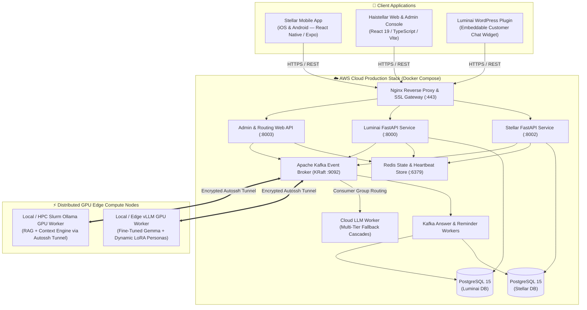

# 🌌 Haistellar

### *Space for Better Life — AI-Powered Products, Low-Latency Systems & Hybrid Cloud-Edge Infrastructure*

---

## 👋 Welcome — For Customers, Recruiters & Hiring Managers

Welcome to **Haistellar** (`haistellar-public`), the public showcase and architectural overview of the Haistellar ecosystem.

**Haistellar** is a full-stack product studio and distributed AI platform created by **Hee Bae** (*Software Engineer & AI Researcher*). From consumer mobile apps on the iOS App Store and Google Play Store to B2B RAG customer support engines, low-latency WebRTC security matrices, and kernel-level Windows 11 desktop utilities, every product in the Haistellar ecosystem is engineered end-to-end for production reliability, ultra-low latency, and cost-efficient AI inference.

- 🌐 **Official Website & Product Portal:** [https://haistellar.com](https://haistellar.com)
- 👨‍💻 **About the Developer & Interactive Resume:** [https://haistellar.com/developer](https://haistellar.com/developer)
- 📬 **Contact:** [hrak109@gmail.com](mailto:hrak109@gmail.com) · [haistellar.products@gmail.com](mailto:haistellar.products@gmail.com)

---

## 🚀 Product Portfolio

### 1. 🌟 [Stellar](https://haistellar.com/products/stellar) — AI Lifestyle Companion & Personal Assistant *(iOS & Android)*
> **Live on the [Apple App Store](https://apps.apple.com/us/app/stellar-ai-life-companions/id6768465620) & [Google Play Store](https://play.google.com/store/apps/details?id=com.haistellar.stellar)**

**Stellar** is a cross-platform mobile application (React Native / Expo / TypeScript) featuring 10 specialized AI companions that integrate conversational intelligence directly with structured personal productivity, health, and security tools:

- **🏋️ AI Fitness Coach & Workout Tracker:** Log workouts through natural conversation or structured tracking with AI-estimated energy expenditure and activity analytics.
- **🥗 Smart Nutritionist & Calorie Tracker:** Describe meals in plain language to automatically calculate and log daily calories, macros, and nutritional goals.
- **🗣️ Multilingual Language Tutor:** Practice English, Korean, and more through natural chat with real-time grammar corrections and contextual phrasing tips.
- **🔐 Zero-Knowledge Security Vault:** Client-side **AES-256** password manager (derived via **PBKDF2** with 10,000 iterations) unlocked with device biometrics (Face ID / Touch ID) so plaintext credentials never leave the user's device.
- **📅 Personal Assistant, Diary, Notes & Scripture Guide:** Integrated calendar & reminder scheduling, rich personal diaries, quick-capture notes, Bible study companion with verse bookmarking, and real-time voice-to-text transcription.

---

### 2. 💬 [Luminai](https://haistellar.com/products/luminai) — Automated B2B AI Customer Support & RAG Engine
> **Product Page:** [https://haistellar.com/products/luminai](https://haistellar.com/products/luminai)

**Luminai** is a context-aware, embeddable AI customer support platform built for businesses and WordPress websites:

- **Custom Knowledge Base & RAG Pipeline:** Businesses upload domain documents, FAQs, and operational policies; Luminai retrieves relevant context via vector embeddings to answer customer inquiries 24/7 with human-like accuracy.
- **WordPress & Elementor Native Plugin:** Drop-in PHP/JS widget and admin dashboard allowing one-click installation, live prompt customization, and real-time support automation.
- **Multi-Tenant Isolation & High Concurrency:** Backed by dedicated FastAPI microservices, Redis caching, and asynchronous Kafka event queues to handle high-volume concurrent customer sessions without latency spikes.

---

### 3. 📹 [Aura](https://haistellar.com/products/aura) — Low-Latency WebRTC Home Security Streaming Matrix
> **Product Page:** [https://haistellar.com/products/aura](https://haistellar.com/products/aura) · **Open Source Repo:** [github.com/hrak109/aura](https://github.com/hrak109/aura)

**Aura** is a glassmorphic, bare-metal home security streaming matrix for **Wyze cameras** on Windows:

- **Sub-Second P2P WebRTC Feeds:** Bridges Wyze cloud camera discovery with the native `go2rtc` streaming engine to deliver ultra-low-latency peer-to-peer WebRTC streams across local network devices.
- **Interactive Matrix Dashboard:** Drag-and-drop camera grid reordering, direct corner-drag column span resizing (`1`–`5` columns) with automatic HD/SD stream switching, frozen-stream watchdog, PC sleep/wake auto-recovery, and dynamic accent themes (*Emerald*, *Cyan*, *Violet*, *Amber*).
- **Native Windows GUI Control Panel & Standalone `.exe`:** Packaged via PyInstaller into a single portable `Aura.exe` featuring a dark-themed Tkinter control panel, live color-coded system logs, configurable auto-restart intervals, and a plug-and-play web Setup Wizard.

---

### 4. 🖱️ Glidify — Apple Magic Trackpad Kinetic Glide for Windows 11
> **Open Source Repo:** [github.com/hrak109/glidify](https://github.com/hrak109/glidify)

**Glidify** brings authentic **macOS / Apple Magic Trackpad inertial glide scrolling** to Windows 11:

- **Viscous Exponential Decay Physics (`appleGlide`):** Transforms notched mouse wheels and rigid Windows precision touchpads into silky-smooth, multi-page kinetic glides with adaptive flick acceleration, spring/cubic easing curves, and a touchpad jitter deadzone filter.
- **Zero-Lag Win32 Kernel Input Hook (`WH_MOUSE_LL`):** Engineered in 64-bit Win32/Rust & Python with immediate sub-microsecond bypass for mouse movement, 1ms multimedia timer precision (`timeBeginPeriod(1)`), 200Hz–240Hz micro-step `SendInput` dispatch, and sub-delta accumulation.
- **Native Fluent Dark GUI & Auto-Signed Standalone `.exe`:** Features a live interactive scroll test playground, real-time telemetry counters, automatic foreground game/CAD blacklist detection, modifier key passthrough (`Ctrl` zoom, `Alt` boost), and automated Authenticode digital code signing.

---

## 🏗️ Haistellar Cloud & Hybrid Edge Infrastructure

Haistellar runs on a **hybrid cloud-and-edge microservice architecture** designed to deliver high availability while **reducing LLM inference costs by ~80%** compared to pure cloud API deployments.

### Key Architectural Highlights

1. **Event-Driven Asynchronous AI Broker (`haistellar-service` & `haistellar-edge`):**
   - API services (`stellar-api`, `luminai-api`, `web-api`) publish structured inference tasks to partitioned **Apache Kafka** topics (`questions-stellar`, `questions-luminai`, `questions-private`, `answers`).
   - Dedicated `answer-consumer` and `reminder-worker` services persist completed AI responses and dispatch scheduled push notifications asynchronously.
2. **Hybrid Cloud-Edge LLM Routing & Multi-Tier Cascades:**
   - **Edge GPU Compute (`vLLM` & `Ollama`):** Local workstation GPUs and HPC cluster nodes (via Slurm + `autossh` persistent tunnels) consume directly from Kafka to run open-weight models (**Gemma**, **Llama**) with **RAG** and **dynamic LoRA persona adapters** at near-zero marginal cost.
   - **Resilient Cloud Fallback Cascades:** When edge nodes are offline or under heavy load, the system dynamically routes requests across configurable **Light**, **Medium**, and **Heavy** cloud cascades (Groq LPU & Google AI models) with automatic failover.
3. **Live Control Plane & Observability (`haistellar-web`):**
   - Real-time React Admin Console visualizing live health across all 5 infrastructure layers (Gateway → Core APIs → Message Brokers → Persistence Nodes → Edge Compute Workers).
   - Instant hot-swapping of global routing modes (`CLOUD_ONLY`, `LOCAL_VLLM_PRIMARY`, `LOCAL_OLLAMA_PRIMARY`, etc.), per-persona/per-language (`EN`/`KO`) cascade mappings, RAG toggles, and LoRA persona switches without redeploying containers.
4. **Production Engineering & Quality Assurance:**
   - Containerized multi-network Docker Compose topology with strict per-service memory limits, automated Alembic schema migrations, zero-downtime Let's Encrypt SSL renewal, and CI/CD pipelines (GitHub Actions, Pytest, Ruff, Jest, ESLint, TypeScript).

---

## 🛠️ Technology Stack Overview

| Layer | Technologies |
| :--- | :--- |
| **AI & Machine Learning** | vLLM, Ollama, LoRA Fine-Tuning (Gemma / Llama), LangChain, RAG / Vector Embeddings, Groq API, Google Gemini / Gemma API |
| **Backend & Distributed Systems** | Python 3.12, FastAPI, Gunicorn/Uvicorn, Apache Kafka (Confluent KRaft), Redis 7, SQLAlchemy, Alembic, PostgreSQL 15, MariaDB |
| **Mobile & Frontend** | React Native, Expo (EAS Build / OTA), React 19, TypeScript, Vite, Tailwind CSS, HTML5 WebRTC (`go2rtc`) |
| **Desktop & Systems** | Rust (Tauri v2), Win32 Low-Level Hooks (`WH_MOUSE_LL`, `SendInput`, `ctypes`), Tkinter Fluent UI, PyInstaller, PowerShell Authenticode |
| **Cloud, DevOps & Testing** | AWS Lightsail / EC2, Docker & Docker Compose, Nginx, Let's Encrypt (Certbot), Slurm HPC, GitHub Actions CI/CD, Pytest, Jest |

---

## 👨‍💻 About the Developer

**Hee Bae** — *Software Engineer & AI Researcher (Toronto, Canada)*

- 🎓 **Education:**
  - **Georgia Institute of Technology** — *M.S. in Computer Science (AI/ML Specialization)*
  - **University of Waterloo** — *Bachelor of Computer Science (AI & Distributed Systems)*
- 💼 **Experience Highlights:**
  - **Founder & Lead Engineer @ Haistellar:** Architected and shipped the full Haistellar ecosystem (Stellar iOS/Android, Luminai RAG, Aura WebRTC, Glidify Windows 11, and the hybrid Kafka/vLLM/FastAPI cloud-edge platform).
  - **Backend Engineer (AI Integration) @ Oakhill Pines:** Built RAG/LangChain business context AI chat and optimized vLLM GPU edge compute, reducing inference costs by 80%.
  - **Software Engineer Intern @ IBM:** Modernized enterprise airline applications and optimized MongoDB query pipelines for 70% faster execution.
  - **Android Engineer Intern @ Ecobee:** Led platform migration for 1M+ active smart-home users, shipping 40+ Android features (Alexa/Spotify integration) with 87% test coverage in Kotlin/RxJava.
  - **Machine Learning Intern @ MindsLab:** Optimized NLP models (+70% relevance) and built Django REST APIs for vector embedding inference.

👉 **View Full Interactive Portfolio & Resume:** [**https://haistellar.com/developer**](https://haistellar.com/developer)

---

## 🔗 Quick Links

| Resource | Link |
| :--- | :--- |
| 🌐 **Haistellar Official Website** | [https://haistellar.com](https://haistellar.com) |
| 📄 **Developer Profile & Resume** | [https://haistellar.com/developer](https://haistellar.com/developer) |
| 📱 **Stellar Product Page** | [https://haistellar.com/products/stellar](https://haistellar.com/products/stellar) |
| 🍎 **Stellar on Apple App Store** | [https://apps.apple.com/us/app/stellar-ai-life-companions/id6768465620](https://apps.apple.com/us/app/stellar-ai-life-companions/id6768465620) |
| 🤖 **Stellar on Google Play** | [https://play.google.com/store/apps/details?id=com.haistellar.stellar](https://play.google.com/store/apps/details?id=com.haistellar.stellar) |
| 💬 **Luminai Product Page** | [https://haistellar.com/products/luminai](https://haistellar.com/products/luminai) |
| 📹 **Aura Product Page** | [https://haistellar.com/products/aura](https://haistellar.com/products/aura) |
| 💻 **Aura Open-Source Repository** | [https://github.com/hrak109/aura](https://github.com/hrak109/aura) |
| 🖱️ **Glidify Open-Source Repository** | [https://github.com/hrak109/glidify](https://github.com/hrak109/glidify) |
| ✉️ **Direct Email** | [hrak109@gmail.com](mailto:hrak109@gmail.com) |

---

  © 2026 Haistellar. Engineered by Hee Bae. All Rights Reserved.

